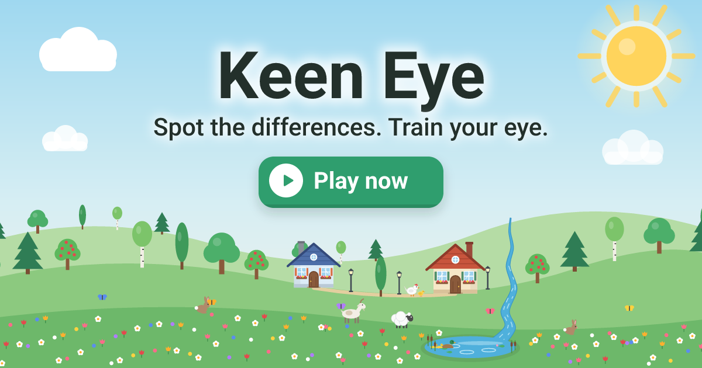

<div align="center">


# Keen Eye

**A cozy spot-the-difference game for Android and iOS.**
Two hand-drawn cartoon scenes, a few sneaky changes — find them all.

Fully offline · no ads · no analytics · 32 languages

[**Play in the browser**](https://dev-northlab.github.io/keen-eye/) · [Google Play](https://play.google.com/store/apps/details?id=com.northlab.keeneye)




</div>

---

## ✨ What's inside

Every picture is a **unique, hand-drawn SVG scene** — no generators, no stock photos. Many scenes are alive: clouds
drift, boats bob, birds fly, and some differences hide *in the motion itself*.

| Mode | Levels | The idea |
|---|---:|---|
| 🌍 **Worlds** | 150 | Five worlds of 30 levels — Farm, City, Forest, Sea, Space. Classic A ↔ B search, 5 to 10 differences, with a harder ten at the end of each world. |
| 🕰️ **Time** | 30 | The same scene at two moments — morning and evening, summer and winter. Light, snow and fallen leaves are natural changes, not differences. |
| 🧠 **Memory** | 30 | Look at picture A for a few seconds, the curtain falls, then find what changed in B — from memory. |
| ✈️ **Travel** | 32 | One recognizable city per country on a world map, a fun fact for each, and a passport stamp for every win. |
| 🔍 **Detective** | 35 | Seven cases of five scenes. Every difference is a clue — collect them and name the culprit. |
| 🏺 **Find the odd one out** | 10 eras | Egypt, Rome, Vikings, a castle, pirates, the Wild West, the Stone Age, samurai Japan, the Aztecs, ancient China — spot what doesn't belong in the era. |
| 🗝️ **Treasury** | 1 bonus | A golden key hides in one level of every world and mode. Find them all to open the treasure. |
| 👫 **Two players** | — | On one device: **duel** (first to tap scores), **hot-seat** (take turns) or **co-op** (one shared score). Face to face on a tablet, too. |

### Made for everyone

- **Calm mode** — no timer, no mistakes, no stars, three hints per level, slower animation and a "stop motion" button.
- **Hard mode** — no hints, only one mistake allowed (the second ends the level), extra objects in the pictures and red
  stars for the best.
- **Pinch to zoom** and pan, shared by both pictures; double tap to zoom in.
- **Hints** given afresh on every attempt: three in calm mode, one in normal mode, none in hard mode.
- **Light and dark themes**, four seasons for the home meadow, music, sound effects and vibration.
- **Reduce motion** support and SVG-only interface icons.
- **32 languages**: English, Русский, Հայերեն, Deutsch, Français, Español, Italiano, Português, Nederlands, Polski,
  Čeština, Română, Български, Українська, Ελληνικά, Magyar, Svenska, Dansk, Norsk, Suomi, Türkçe, العربية, हिन्दी,
  Bahasa Indonesia, Bahasa Melayu, Filipino, Tiếng Việt, ไทย, 简体中文, 繁體中文, 日本語, 한국어.
- **One purchase, no ads.** The first levels of every mode are free; a single "full game" purchase opens the rest.
  Progress is stored on the device only — nothing ever leaves it.

---

## 🚀 Getting started

You need **Node.js 24** (the scripts run TypeScript with Node's built-in type stripping).

```bash
npm install
npm run dev        # http://localhost:3000
```

The game is developed and tested in the browser first; touch and mouse both work.

### Commands

| Command | What it does |
|---|---|
| `npm run dev` | Dev server at `http://localhost:3000` |
| `npm run build` | Type check + production build into `dist/` |
| `npm run typecheck` | Type check only |
| `npm test` | Unit tests (`tests/*.test.ts`, `node:test`) |
| `npm run check-levels [-- <id> ...]` | Level validator: renders A and B and checks every difference, zone and motion |
| `npm run preview-levels [-- <id> ...]` | Writes `previews/level-NNN.png` — A \| B with the zones outlined |
| `npm run icons` | Renders the app icon, splash and store icons |
| `npm run og` | Renders the link preview `public/og-image.png` |
| `npm run android:sync` / `android:apk` | Web build + `cap sync android` / also a debug APK |
| `npm run ios:sync` | Web build + `cap sync ios` |

---

## 📱 Mobile builds

**Android** — Gradle needs **JDK 21** in `JAVA_HOME` and the Android SDK in `ANDROID_HOME`.

```bash
npm run android:apk
adb install -r android/app/build/outputs/apk/debug/app-debug.apk
```

Debug builds allow WebView DevTools via `chrome://inspect`.

**iOS** — the Xcode project uses Swift Package Manager and is built in the cloud by
[Codemagic](https://codemagic.io): the `ios-testflight` workflow in [`codemagic.yaml`](codemagic.yaml) builds and
uploads to TestFlight (setup steps are at the top of the file).

**Web** — every push to `main` publishes a test build to
[GitHub Pages](https://dev-northlab.github.io/keen-eye/) ([`.github/workflows/pages.yml`](.github/workflows/pages.yml)).

---

## 🧩 How it's built

| Layer | Tech |
|---|---|
| UI | Vue 3 (`<script setup>`), TypeScript, Vite |
| State | Pinia — progress, settings, purchase, two-player setup |
| Routing | Vue Router, HTML5 history |
| Text | vue-i18n, one JSON file per language |
| Native | Capacitor 8 — Preferences, Haptics, Share, Browser, App |

The **game scene is plain TypeScript** in [`src/engine/`](src/engine) with no Vue inside: it owns its DOM, runs on
`requestAnimationFrame`, and talks to the screens only through callbacks (`onFound`, `onMiss`, `onComplete`, …).
That keeps the hot path fast and lets the level validator run the same code in Node.

```
src/
├── engine/       game scene: rendering, animation, zoom, gestures, rules, two-player match
├── levels/       hand-drawn SVG levels, one file each, grouped by world and mode
├── views/        screens (home, worlds, level, memory, travel, detective, duo, settings, …)
├── components/   dialogs, HUD, world map, backdrops, switches
├── stores/       Pinia stores
├── services/     storage, audio, haptics, theme, purchases, Android back button
├── i18n/         21 locales
└── router/       routes and the unlock / purchase guard
scripts/          level validator, previews, icon and link-preview renderers
docs/             game spec and the design of every mode
```

### Writing a level

Levels are SVG drawn in code. `diff(x, y, r, a, b)` draws `a` in picture A and `b` in picture B and registers the
difference zone, so zones are never listed by hand:

```ts
// src/levels/chapter-01/level-001.ts (shortened)
export default svgLevel({
  id: 1,
  chapter: 'farm',
  title: 'barnyard',
  parTimeSec: 60,
  scene: ({ diff, anim }) =>
    `<rect width="800" height="500" fill="#a8dcf5"/>` +
    // The sun turns orange in picture B.
    diff(700, 85, 46, sun(700, 85), sun(700, 85, '#ff8c42')) +
    // This cloud is missing in picture B.
    diff(400, 70, 62, cloud(400, 80), '') +
    // A cloud drifting in both pictures.
    anim({ type: 'path', points: [[0, 0], [60, 0]], period: 24 }, cloud(160, 110, 0.8)) +
    tree(130, 345),
})
```

Then register it in `src/levels/index.ts`, add its title to every locale, and run:

```bash
npm run check-levels -- 1
npm run preview-levels -- 1
```

The validator renders both pictures at several animation moments and fails if they differ outside a zone, if a zone
shows no difference, if zones overlap, or if the level breaks its difficulty rules
([`src/levels/difficulty.ts`](src/levels/difficulty.ts)).

---

## 📚 Docs

- [Game spec](docs/SPEC.md)
- [Two players](docs/keen-eye-two-players.md)
- [Time](docs/time-differences-mode.md) · [Memory](docs/memory-mode.md) · [Travel](docs/world-travel-mode.md) ·
  [Detective](docs/detective-mode.md) · [Find the odd one out](docs/anachronism-mode.md)
- [Hidden keys and the treasury](docs/hidden-item-feature.md)

---

<div align="center">

Made with care by **Northlab** · [dev.northlab@gmail.com](mailto:dev.northlab@gmail.com)

</div>
